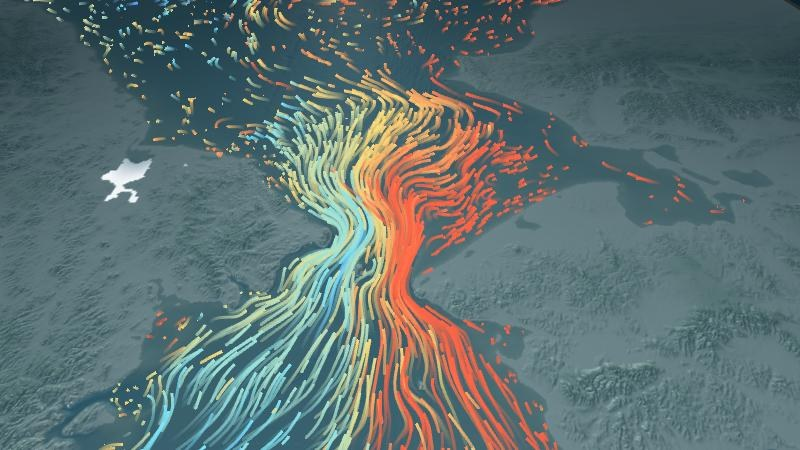

# The water melts the ice: the Bering Strait in open data

**How warmer Pacific water through the Bering Strait is shrinking Arctic sea ice.**

A 3D page of Pacific water flowing through the Bering Strait into the Arctic, over the real seabed, in eight years from 1995 to 2023, beside 35 years of measurements from moorings in the strait and 47 years of sea ice seen from space.

- **Open the page:** https://likrentai.github.io/beringstrait/
- **Case study:** https://likrentai.github.io/beringstrait/case-study.html ([PDF](docs/case-study.pdf))

## What we found

More and warmer Pacific water now flows north through the strait: 29% more flow and about twice the heat since 1991 (mooring measurements). Year by year, the heat carried north from June to November matches the sea ice in November closely (r = −0.86 over 28 years; −0.82 with both trends removed): the years with the most heat are the years the Chukchi Sea freezes latest. Published studies find that losing the ice has not changed the flow, while the heat through the strait times the spring melt and the autumn freeze-up. This project does not add new science; it shows that the published picture holds when the open measurements are put side by side. Details and limits are in the case study.

## How it is built

| Notebook | What it does |
|---|---|
| 00bathymetry | Cuts the IBCAO 5.2 grid (200 m) to the Bering and Chukchi seas in a local map projection. |
| 01webterrain | Makes the height image, coloured texture and metadata for the web page. |
| 02hycomdownload, 02a to 02g | Download HYCOM currents and temperature (top 100 m), one notebook per year: 1995, 2000, 2005, 2010, 2015 (reanalysis), 2019, 2020, 2023 (analysis). |
| 03moorings | Reads the University of Washington yearly and monthly means. |
| 04hycommonthly | Monthly means of the model, flow across the strait, and the model against the moorings. |
| 05particles | Moves about 8,000 particles a month through the model currents and writes compact track files. |
| 06seaice | Downloads NOAA/NSIDC sea ice and makes the monthly ice pictures and the ice chart data. |
| 07casestudy | Redraws the case study charts. |
| make_inset.py | Builds the small "where you are looking" map from Natural Earth coastlines. |

The page (docs/index.html) uses deck.gl 9.4.1: a TerrainLayer for the seabed, a TripsLayer for the moving water and a BitmapLayer for the ice.

To run the notebooks: Python 3.14, `uv venv --python 3.14`, then `uv pip install -r requirements.txt`. The raw downloads (IBCAO 3.4 GB, HYCOM about 1.5 GB, NSIDC, UW mooring files) are not in this repository; each notebook's first section says where its inputs come from and where they go (data/raw). To view the page locally, run `python -m http.server 8000` inside docs and open http://localhost:8000/.

## Data and credits

- **Currents and temperature:** HYCOM GOFS 3.1 (HYCOM consortium): reanalysis GLBv0.08 expt_53.X and analysis GLBy0.08 expt_93.0, through the NCSS service at ncss.hycom.org.
- **Measured flow, temperature and heat:** Bering Strait mooring data, R. A. Woodgate, University of Washington. Woodgate, R.A., K. Stafford and F. Prahl (2015), Oceanography 28(3):46-67, doi:10.5670/oceanog.2015.57; Woodgate, R.A. (2018), Progress in Oceanography 160:124-154; Woodgate, R.A. and C. Peralta-Ferriz (2021), Geophysical Research Letters, doi:10.1029/2021GL092528. The data providers ask users to email them with publication references.
- **Sea ice:** NOAA/NSIDC Climate Data Record of Passive Microwave Sea Ice Concentration, version 6, doi:10.7265/b18j-z797, through NOAA CoastWatch ERDDAP.
- **Seabed and land:** IBCAO 5.2, International Bathymetric Chart of the Arctic Ocean.
- **Coastlines (inset map):** Natural Earth, through world-atlas 2.0.2.
- **Studies cited in the findings:** Serreze, Crawford, Stroeve, Barrett and Woodgate (2016), J. Geophys. Res. Oceans 121; Margevich, Timmermans and Danielson (2024), J. Geophys. Res. Oceans 129; Peralta-Ferriz and Woodgate (2023), Geophys. Res. Lett. 50; Woodgate, Weingartner and Lindsay (2010), Geophys. Res. Lett. 37.

This is an independent project, not affiliated with or endorsed by any of the sources.

## Licence

Code (notebooks, make_inset.py and the HTML pages): MIT, see LICENSE. The processed data in docs/data are derived from the sources above and remain under their terms. Fonts in docs/fonts (Bricolage Grotesque, Newsreader): SIL Open Font License.

Lik Ren Tai, November 2026
